# Analytics Platform — PostgreSQL Data Model & Isolation Specification

## 1. Entity-Relationship Overview

```mermaid
erDiagram
    APPLICATIONS ||--o{ API_KEYS : issues
    APPLICATIONS ||--o{ EVENTS : records
    APPLICATIONS ||--o{ SESSIONS : tracks
    APPLICATIONS ||--o{ DAILY_APP_METRICS : aggregates
    APPLICATIONS ||--o{ USER_APP_PERMISSIONS : assigns
    USERS ||--o{ USER_APP_PERMISSIONS : holds
    USERS ||--o{ AUDIT_LOGS : generates

    APPLICATIONS {
        varchar app_id PK "e.g. askanna, groundworks, roomlyst"
        varchar name "Human-readable app name"
        varchar status "ACTIVE, SUSPENDED"
        text allowed_origins "Comma-separated domain allowlist"
        timestamptz created_at
        timestamptz updated_at
    }

    API_KEYS {
        uuid id PK
        varchar app_id FK
        varchar environment "test, live"
        varchar key_hash "SHA-256 of write_key"
        varchar prefix "e.g. apk_live_9f2a"
        varchar name "Key label / description"
        varchar status "ACTIVE, REVOKED, EXPIRED"
        timestamptz created_at
        timestamptz expires_at
        timestamptz revoked_at
    }

    EVENTS {
        uuid event_id PK "Composite PK (event_id, timestamp)"
        varchar app_id FK
        varchar environment "test, live"
        varchar event_type "pageview, custom, timing"
        varchar event_name "e.g. page_view, chat_start"
        varchar visitor_id "Pseudonymous UUID (null in NO_STORAGE)"
        varchar session_id "Ephemeral session UUID"
        text page_path "Sanitized URL path (no secret queries)"
        varchar referrer_domain "Coarse referrer domain"
        varchar device_family "desktop, mobile, tablet, bot"
        varchar os_family "Windows, macOS, iOS, Android, Linux"
        varchar browser_family "Chrome, Safari, Firefox, Edge"
        varchar country_code "ISO 3166-1 alpha-2"
        varchar region_code "ISO 3166-2 subdivision"
        varchar city_name "Coarse city name"
        varchar ip_masked "Masked IPv4 (/24) or null"
        integer duration_ms "Optional timing metric"
        jsonb metadata "Sanitized attributes (zero PII)"
        timestamptz timestamp PK "Range partition key"
    }

    SESSIONS {
        uuid id PK
        varchar session_id "Client session identifier"
        varchar app_id FK
        varchar environment "test, live"
        varchar visitor_id "Associated visitor ID"
        timestamptz started_at
        timestamptz ended_at
        integer duration_seconds
        integer pageviews_count
        text entry_page
        text exit_page
        boolean is_bounce
        varchar referrer_domain
        varchar country_code
        varchar device_family
    }

    DAILY_APP_METRICS {
        date metric_date PK
        varchar app_id PK
        varchar environment PK "test, live"
        integer total_pageviews
        integer total_events
        integer unique_sessions
        integer unique_visitors
        integer bounce_count
        integer avg_session_duration_sec
    }

    USERS {
        uuid id PK
        varchar email UK "Admin user email"
        varchar password_hash "Argon2id or bcrypt hash"
        varchar role "SuperAdmin, AppAdmin, AppViewer"
        varchar status "ACTIVE, SUSPENDED"
        timestamptz created_at
        timestamptz last_login_at
    }

    USER_APP_PERMISSIONS {
        uuid id PK
        uuid user_id FK
        varchar app_id FK
        varchar granted_role "AppAdmin, AppViewer"
        timestamptz granted_at
    }

    AUDIT_LOGS {
        uuid id PK
        uuid user_id FK
        varchar action "EXPORT_CSV, ROTATE_KEY, DELETE_DATA, LOGIN"
        varchar app_id "Target application scope"
        varchar environment "test, live"
        jsonb details "Export parameters, row counts, key IDs"
        varchar ip_address "Admin IP address"
        timestamptz timestamp
    }
```



---

## 2. PostgreSQL DDL Schema Definitions

### 2.1 Enums and Extension Initialization
```sql
-- Extensions
CREATE EXTENSION IF NOT EXISTS "uuid-ossp";
CREATE EXTENSION IF NOT EXISTS "pgcrypto";

-- Enums
CREATE TYPE environment_type AS ENUM ('test', 'live');
CREATE TYPE app_status_type AS ENUM ('ACTIVE', 'SUSPENDED', 'ARCHIVED');
CREATE TYPE key_status_type AS ENUM ('ACTIVE', 'REVOKED', 'EXPIRED');
CREATE TYPE user_role_type AS ENUM ('SuperAdmin', 'AppAdmin', 'AppViewer');
CREATE TYPE event_category_type AS ENUM ('pageview', 'custom', 'click', 'timing');
```

### 2.2 Applications & Tenant Configuration
```sql
CREATE TABLE applications (
    app_id VARCHAR(64) PRIMARY KEY,
    name VARCHAR(255) NOT NULL,
    status app_status_type NOT NULL DEFAULT 'ACTIVE',
    allowed_origins TEXT NOT NULL DEFAULT '', -- JSON array or comma-delimited
    created_at TIMESTAMPTZ NOT NULL DEFAULT NOW(),
    updated_at TIMESTAMPTZ NOT NULL DEFAULT NOW()
);

-- Seed initial corporate applications
INSERT INTO applications (app_id, name, status, allowed_origins) VALUES
('askanna', 'AskAnna AI Intelligence', 'ACTIVE', 'https://askanna.ai,https://test.askanna.ai'),
('groundworks', 'GroundWorks Real Estate & GCNav', 'ACTIVE', 'https://gcnav2.com,https://groundworks.com'),
('roomlyst', 'Roomlyst Interior Design', 'ACTIVE', 'https://roomlyst.com,https://app.roomlyst.com'),
('nutrilens', 'NutriLens Nutrition AI', 'ACTIVE', 'https://nutrilens.app');
```

### 2.3 API Keys Table (Hashed Storage)
```sql
CREATE TABLE api_keys (
    id UUID PRIMARY KEY DEFAULT gen_random_uuid(),
    app_id VARCHAR(64) NOT NULL REFERENCES applications(app_id) ON DELETE CASCADE,
    environment environment_type NOT NULL,
    key_hash VARCHAR(64) NOT NULL UNIQUE, -- SHA-256 hex digest
    prefix VARCHAR(32) NOT NULL,          -- e.g. 'apk_live_9f2a'
    name VARCHAR(255) NOT NULL,
    status key_status_type NOT NULL DEFAULT 'ACTIVE',
    created_at TIMESTAMPTZ NOT NULL DEFAULT NOW(),
    expires_at TIMESTAMPTZ NULL,
    revoked_at TIMESTAMPTZ NULL
);

CREATE INDEX idx_api_keys_lookup ON api_keys(key_hash) WHERE status = 'ACTIVE';
CREATE INDEX idx_api_keys_app ON api_keys(app_id, environment);
```

### 2.4 Partitioned Events Table
```sql
CREATE TABLE events (
    event_id UUID NOT NULL DEFAULT gen_random_uuid(),
    app_id VARCHAR(64) NOT NULL REFERENCES applications(app_id) ON DELETE CASCADE,
    environment environment_type NOT NULL,
    event_type event_category_type NOT NULL,
    event_name VARCHAR(128) NOT NULL,
    visitor_id VARCHAR(128) NULL,          -- Pseudonymous random UUID
    session_id VARCHAR(128) NULL,          -- Ephemeral session UUID
    page_path TEXT NOT NULL,               -- Scrubbed URL path
    referrer_domain VARCHAR(255) NULL,     -- Hostname only
    device_family VARCHAR(32) NULL,        -- 'desktop', 'mobile', 'tablet'
    os_family VARCHAR(32) NULL,            -- 'Windows', 'macOS', 'iOS', 'Android'
    browser_family VARCHAR(32) NULL,       -- 'Chrome', 'Safari', 'Firefox'
    country_code VARCHAR(2) NULL,          -- ISO 3166-1 alpha-2
    region_code VARCHAR(8) NULL,           -- State/province
    city_name VARCHAR(128) NULL,           -- Coarse city
    ip_masked VARCHAR(45) NULL,            -- /24 masked IP (e.g. '192.168.1.0')
    duration_ms INTEGER NULL,              -- Duration/timing metric
    metadata JSONB NOT NULL DEFAULT '{}'::jsonb,
    timestamp TIMESTAMPTZ NOT NULL,
    PRIMARY KEY (event_id, timestamp)
) PARTITION BY RANGE (timestamp);

-- Range Partition Definition (Example monthly partitions)
CREATE TABLE events_y2026m11 PARTITION OF events
    FOR VALUES FROM ('2026-11-01 00:00:00+00') TO ('2026-12-01 00:00:00+00');

CREATE TABLE events_y2026m12 PARTITION OF events
    FOR VALUES FROM ('2026-12-01 00:00:00+00') TO ('2027-01-01 00:00:00+00');

-- Indexes on partitioned table (automatically created on child partitions)
CREATE INDEX idx_events_app_env_time ON events (app_id, environment, timestamp DESC);
CREATE INDEX idx_events_visitor ON events (app_id, environment, visitor_id, timestamp DESC) WHERE visitor_id IS NOT NULL;
CREATE INDEX idx_events_session ON events (session_id, timestamp ASC) WHERE session_id IS NOT NULL;
CREATE INDEX idx_events_event_name ON events (app_id, environment, event_name, timestamp DESC);
CREATE INDEX idx_events_metadata_gin ON events USING GIN (metadata);
```

### 2.5 Pre-Aggregated Daily Rollups
```sql
CREATE TABLE daily_app_metrics (
    metric_date DATE NOT NULL,
    app_id VARCHAR(64) NOT NULL REFERENCES applications(app_id) ON DELETE CASCADE,
    environment environment_type NOT NULL,
    total_pageviews INTEGER NOT NULL DEFAULT 0,
    total_events INTEGER NOT NULL DEFAULT 0,
    unique_sessions INTEGER NOT NULL DEFAULT 0,
    unique_visitors INTEGER NOT NULL DEFAULT 0,
    bounce_count INTEGER NOT NULL DEFAULT 0,
    avg_session_duration_sec INTEGER NOT NULL DEFAULT 0,
    PRIMARY KEY (metric_date, app_id, environment)
);

CREATE TABLE daily_page_metrics (
    metric_date DATE NOT NULL,
    app_id VARCHAR(64) NOT NULL REFERENCES applications(app_id) ON DELETE CASCADE,
    environment environment_type NOT NULL,
    page_path TEXT NOT NULL,
    views_count INTEGER NOT NULL DEFAULT 0,
    unique_visitors INTEGER NOT NULL DEFAULT 0,
    entry_count INTEGER NOT NULL DEFAULT 0,
    exit_count INTEGER NOT NULL DEFAULT 0,
    PRIMARY KEY (metric_date, app_id, environment, page_path)
);

CREATE TABLE daily_geo_metrics (
    metric_date DATE NOT NULL,
    app_id VARCHAR(64) NOT NULL REFERENCES applications(app_id) ON DELETE CASCADE,
    environment environment_type NOT NULL,
    country_code VARCHAR(2) NOT NULL,
    region_code VARCHAR(8) NOT NULL DEFAULT '',
    visitor_count INTEGER NOT NULL DEFAULT 0,
    pageview_count INTEGER NOT NULL DEFAULT 0,
    PRIMARY KEY (metric_date, app_id, environment, country_code, region_code)
);
```

### 2.6 Users, Permissions & Audit Logging
```sql
CREATE TABLE users (
    id UUID PRIMARY KEY DEFAULT gen_random_uuid(),
    email VARCHAR(255) NOT NULL UNIQUE,
    password_hash VARCHAR(255) NOT NULL,
    role user_role_type NOT NULL DEFAULT 'AppViewer',
    status VARCHAR(32) NOT NULL DEFAULT 'ACTIVE',
    created_at TIMESTAMPTZ NOT NULL DEFAULT NOW(),
    last_login_at TIMESTAMPTZ NULL
);

CREATE TABLE user_app_permissions (
    id UUID PRIMARY KEY DEFAULT gen_random_uuid(),
    user_id UUID NOT NULL REFERENCES users(id) ON DELETE CASCADE,
    app_id VARCHAR(64) NOT NULL REFERENCES applications(app_id) ON DELETE CASCADE,
    granted_role user_role_type NOT NULL DEFAULT 'AppViewer',
    granted_at TIMESTAMPTZ NOT NULL DEFAULT NOW(),
    UNIQUE (user_id, app_id)
);

CREATE TABLE audit_logs (
    id UUID PRIMARY KEY DEFAULT gen_random_uuid(),
    user_id UUID NOT NULL REFERENCES users(id) ON DELETE CASCADE,
    action VARCHAR(64) NOT NULL,
    app_id VARCHAR(64) NULL,
    environment environment_type NULL,
    details JSONB NOT NULL DEFAULT '{}'::jsonb,
    ip_address VARCHAR(45) NULL,
    timestamp TIMESTAMPTZ NOT NULL DEFAULT NOW()
);

CREATE INDEX idx_audit_logs_user ON audit_logs (user_id, timestamp DESC);
CREATE INDEX idx_audit_logs_app ON audit_logs (app_id, timestamp DESC);
```

### 2.7 Least-Privilege Database Roles (COND-03)
```sql
-- Role 1: Migration / DDL Administrator (Owns schema, runs Alembic)
-- Uses credentials managed in Secret Manager: analytics-db-admin-credentials

-- Role 2: Ingestion Service Role (Write-only telemetry path)
CREATE ROLE analytics_ingest WITH LOGIN PASSWORD 'change_in_secret_manager';
GRANT CONNECT ON DATABASE analytics_db TO analytics_ingest;
GRANT USAGE ON SCHEMA public TO analytics_ingest;
GRANT SELECT ON applications, api_keys TO analytics_ingest;
GRANT INSERT ON events TO analytics_ingest;
-- Strictly NO SELECT/UPDATE/DELETE on events; NO access to users or audit_logs

-- Role 3: Administrative Dashboard Role (Query & Governance path)
CREATE ROLE analytics_dashboard WITH LOGIN PASSWORD 'change_in_secret_manager';
GRANT CONNECT ON DATABASE analytics_db TO analytics_dashboard;
GRANT USAGE ON SCHEMA public TO analytics_dashboard;
GRANT SELECT ON applications, api_keys, users, user_app_permissions, audit_logs TO analytics_dashboard;
GRANT SELECT ON events, sessions, daily_app_metrics, daily_page_metrics, daily_geo_metrics TO analytics_dashboard;
GRANT INSERT ON audit_logs, api_keys, users, user_app_permissions TO analytics_dashboard;
GRANT UPDATE ON events TO analytics_dashboard; -- Strictly for GDPR erasure pipeline
GRANT UPDATE ON api_keys, users TO analytics_dashboard;
```

---

## 3. PostgreSQL Row-Level Security (RLS) Implementation (COND-02)

To guarantee database-level isolation between applications and environments, Row-Level Security is enabled across all telemetry and metric tables. `FORCE ROW LEVEL SECURITY` is applied so table owners and application roles cannot bypass policies.

```sql
-- 1. Enable and Force RLS on events table
ALTER TABLE events ENABLE ROW LEVEL SECURITY;
ALTER TABLE events FORCE ROW LEVEL SECURITY;

-- 2. Split RLS Policies on events table:
-- Policy A: SELECT Policy (Restricted by active session configuration)
CREATE POLICY events_tenant_select_policy ON events
    FOR SELECT
    USING (
        current_setting('app.is_superadmin', true) = 'true'
        OR (
            app_id = current_setting('app.current_app_id', true)
            AND environment::text = current_setting('app.current_environment', true)
        )
    );

-- Policy B: INSERT Policy (Supports write-only ingestion)
CREATE POLICY events_ingest_insert_policy ON events
    FOR INSERT
    WITH CHECK (
        -- Allow insertion if session variables match, OR if executing as analytics_ingest role
        current_user = 'analytics_ingest'
        OR current_setting('app.is_superadmin', true) = 'true'
        OR (
            app_id = current_setting('app.current_app_id', true)
            AND environment::text = current_setting('app.current_environment', true)
        )
    );

-- Policy C: UPDATE Policy (Scoped strictly to GDPR deletion pipeline)
CREATE POLICY events_admin_update_policy ON events
    FOR UPDATE
    USING (
        current_setting('app.is_superadmin', true) = 'true'
        OR (
            app_id = current_setting('app.current_app_id', true)
            AND environment::text = current_setting('app.current_environment', true)
        )
    )
    WITH CHECK (
        visitor_id = 'DELETED_ANONYMIZED'
    );

-- 3. Enable and Force RLS on sessions table
ALTER TABLE sessions ENABLE ROW LEVEL SECURITY;
ALTER TABLE sessions FORCE ROW LEVEL SECURITY;

CREATE POLICY sessions_tenant_isolation_policy ON sessions
    FOR ALL
    USING (
        current_setting('app.is_superadmin', true) = 'true'
        OR (
            app_id = current_setting('app.current_app_id', true)
            AND environment::text = current_setting('app.current_environment', true)
        )
    )
    WITH CHECK (
        app_id = current_setting('app.current_app_id', true)
        AND environment::text = current_setting('app.current_environment', true)
    );

-- 4. Enable RLS on Rollup Tables
ALTER TABLE daily_app_metrics ENABLE ROW LEVEL SECURITY;
ALTER TABLE daily_app_metrics FORCE ROW LEVEL SECURITY;

CREATE POLICY app_metrics_isolation_policy ON daily_app_metrics
    FOR ALL
    USING (
        current_setting('app.is_superadmin', true) = 'true'
        OR (
            app_id = current_setting('app.current_app_id', true)
            AND environment::text = current_setting('app.current_environment', true)
        )
    );
```

### Connection Session Setup Protocol in FastAPI:
When an administrative request is handled by the backend:
```python
async with db_pool.acquire() as conn:
    async with conn.transaction():
        await conn.execute("SET LOCAL app.current_app_id = $1;", app_id)
        await conn.execute("SET LOCAL app.current_environment = $1;", environment)
        # Any subsequent SELECT query is physically restricted by PostgreSQL RLS
        rows = await conn.fetch("SELECT * FROM events WHERE ...")
```
If a developer accidentally omits `app_id` in their ORM query, PostgreSQL returns **zero rows**, preventing cross-tenant leakage.

---

## 4. Migration and Maintenance Strategy (COND-05)

1. **Alembic Versioning:** All schema changes are tracked in sequential migration scripts under `api/migrations/versions/`.
2. **Automated Partition Lifecycle:** In Milestone M1, Alembic pre-creates upcoming monthly partitions (`events_yYYYYmMM`) and automatically drops partitions older than 90 days (`DROP TABLE events_yYYYYmMM`).
3. **Sessions Table Retention:** The `sessions` table is maintained via an automated daily batch purge function:
   ```sql
   DELETE FROM sessions WHERE started_at < NOW() - INTERVAL '90 days';
   ```
   This ensures `sessions` storage mirrors the 90-day retention ceiling of raw events without unbounded growth.
