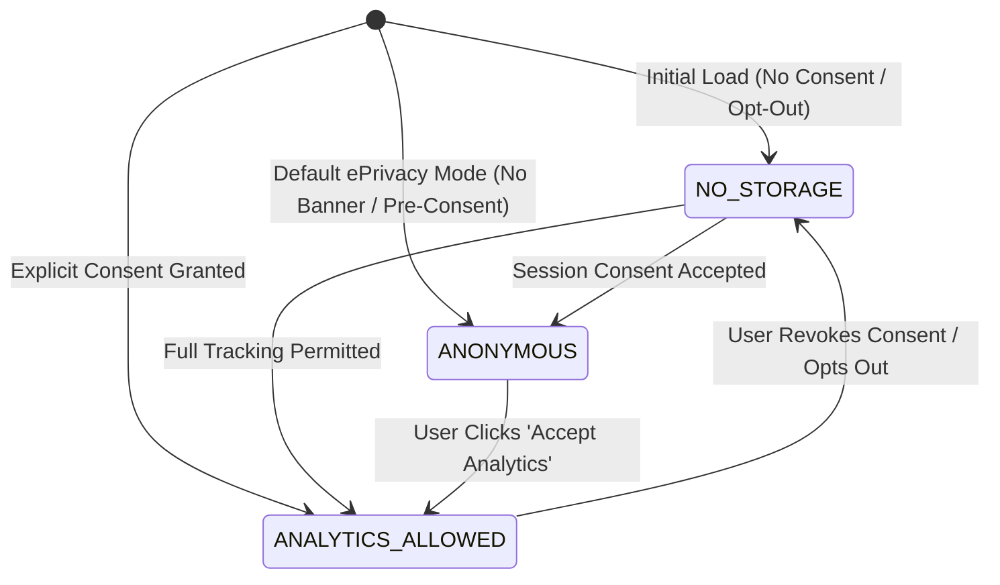
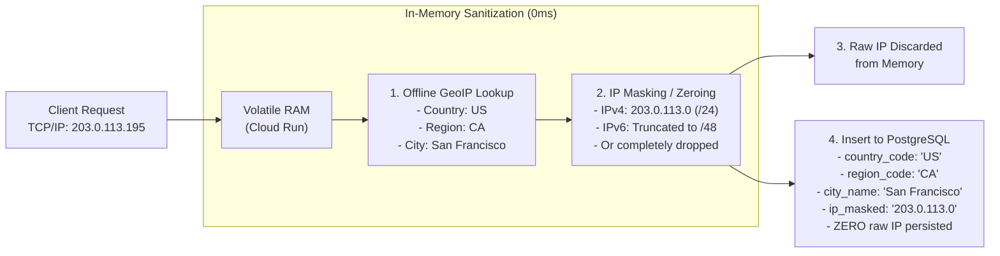

# Analytics Platform — Privacy, Identification & Consent Safeguards

## 1. Core Privacy Philosophy & Legal Foundations

The Analytics Platform adheres to a strict "Privacy-by-Design" architecture. It complies with:
- **General Data Protection Regulation (GDPR - EU 2016/679):** Data minimization (Art. 5(1)(c)), purpose limitation (Art. 5(1)(b)), and right to erasure (Art. 17).
- **ePrivacy Directive (Directive 2002/58/EC as amended):** Strict consent requirements regarding client device terminal storage (cookies, `localStorage`).
- **California Consumer Privacy Act (CCPA) / CPRA:** Consumer right to opt out, delete personal information, and strict limitations on cross-context tracking.
- **Project Governance Rules (`AGENTS.md`):**
  > **"No persistent first-party visitor identifiers before applicable consent conditions; provide no-storage mode; never fingerprint people or collect VIN, user messages, URLs with secrets, raw IP in analytics event records, PII or precise GPS."**

---

## 2. Three-Tier Consent Architecture

The Browser SDK exposes a configurable consent API that governs local storage access and visitor identification.



### Detailed Consent Tier Rules:

#### 1. Tier 1: `NO_STORAGE` (Zero-Storage / Opt-Out Mode)
- **Applicability:** Activated when a user explicitly declines cookies, uses "Strict Privacy" browser settings, or when the host application operates in zero-footprint mode.
- **Client Storage:** Zero cookies, zero `localStorage`, zero `sessionStorage`.
- **Visitor Identification:** `visitor_id` is set to `null` or an ephemeral UUID stored strictly in JavaScript volatile memory. On browser reload or navigation to an external site, this memory is cleared.
- **Session Tracking:** No cross-page session stitching. Each pageview is recorded as an independent aggregate event.
- **Data Collected:** Page path, referrer domain, coarse geography (from in-memory IP lookup), browser/OS family.

#### 2. Tier 2: `ANONYMOUS` (Session-Only / Pre-Consent Mode)
- **Applicability:** The default operating mode for web applications operating under ePrivacy guidelines prior to explicit cookie banner interaction.
- **Client Storage:** Uses `sessionStorage` exclusively. Data stored in `sessionStorage` is automatically wiped by the browser when the tab or window is closed.
- **Visitor Identification:** No persistent cross-session identifier. A random UUIDv4 session token (`session_id`) is stored in `sessionStorage` to link pageviews within the same tab visit.
- **Session Expiration:** 30 minutes of user inactivity automatically clears the session.
- **Data Collected:** Multi-page session duration, bounce rate, entry/exit paths, coarse geography.

#### 3. Tier 3: `ANALYTICS_ALLOWED` (Persistent Pseudonymous Analytics)
- **Applicability:** Activated only after the user explicitly accepts analytical cookies/storage via the host application's consent banner.
- **Client Storage:** First-party `localStorage` key: `_ap_vid`.
- **Visitor Identification:** Random, pseudonymous UUIDv4 (`vid_9f2a4b8c-...`).
- **Session Tracking:** Multi-session retention. Identifies returning vs new visitors over a 365-day rolling window.
- **Data Collected:** Cohort retention, return frequency, full customer lifecycle attribution.

---

## 3. Ban on Device Fingerprinting

The platform categorically prohibits and actively avoids all forms of device fingerprinting:
1. **No Canvas or WebGL Fingerprinting:** The SDK contains no code to render hidden canvas elements, extract GPU driver signatures, or query WebGL parameters.
2. **No Audio Fingerprinting:** No audio context oscillator probes or latency tests are performed.
3. **No Font Enumeration:** No CSS font probing or font-family timing tests.
4. **No Hardware Profiling:** No collection of exact screen color depth, battery status API, CPU core counts, or device benchmark timings.
5. **Heuristic User-Agent Normalization:** Raw `User-Agent` strings are parsed in-memory into coarse categories (e.g. `Browser: Chrome 122`, `OS: Windows 11`, `Device: Desktop`) and are never combined to create persistent fingerprint hashes.

---

## 4. IP Address & Geolocation Sanitization Pipeline

Raw IP addresses are considered personal data under GDPR Article 4(1). The ingestion pipeline processes IP addresses with zero-retention guarantees:



- **Database Guarantee:** The PostgreSQL database schema has no column for raw IP addresses.
- **Log Guarantee:** Cloud Run request logging is configured to suppress client IP addresses from application logs.

---

## 5. URL Query Parameter Sanitization & PII Exclusion

### 5.1 Sensitive Query Parameter Scrubbing
Web URLs often accidentally contain sensitive authentication tokens or user email addresses (e.g., password reset links, magic login links, affiliate redirects).

The SDK and server-side ingestion pipeline apply a strict denylist filter against all URL query strings. Any parameter matching the following case-insensitive expressions is replaced with `[REDACTED]`:

```
token, auth, key, api_key, password, passwd, secret, ssn, vin,
email, mail, user, username, session, session_id, access_token,
refresh_token, code, id_token, verification_code, magic_link
```

*Example:*  
- Incoming URL: `https://askanna.ai/chat?session_id=98765&token=eyJhbGciOi...&ref=twitter`  
- Persisted `page_path`: `/chat?session_id=[REDACTED]&token=[REDACTED]&ref=twitter`

### 5.2 Prohibited Data Fields in Custom Payloads
Host applications using the SDK are strictly prohibited from forwarding the following data types. The server-side Pydantic validation schema automatically rejects payloads containing these keys:

1. **Vehicle Identification Numbers (VIN):** Relevant to automotive/real-estate apps like GroundWorks; strict prohibition prevents vehicle tracking.
2. **Customer Chat Messages & Transcripts:** For AskAnna, only interaction metadata (e.g. `event_name = 'chat_message_sent'`, `duration_ms = 450`) may be logged. Plaintext message contents must never be passed to analytics.
3. **Financial & Identity Records:** Credit card numbers, Social Security Numbers, banking details.
4. **Precise GPS Coordinates:** Exact latitude/longitude is prohibited. Telemetry is restricted to country, region, and city.

---

## 6. Retention, Deletion & Right-to-be-Forgotten Pipeline

### 6.1 Automated Raw Data Pruning (90 Days)
- Raw event records in `events` are organized into monthly partitions.
- At day 91, the entire partition table is dropped via `DROP TABLE events_yYYYYmMM`.
- Storage is instantaneously reclaimed without I/O degradation or table fragmentation.

### 6.2 Pre-Aggregated Statistical Retention (400 Days)
- Historical trends are preserved in pre-aggregated tables (`daily_app_metrics`, `daily_page_metrics`, `daily_geo_metrics`).
- These tables contain strictly numerical sums and averages (e.g., total pageviews on 2026-10-15: 42,500). They contain **zero visitor IDs**, making them completely anonymous and exempt from personal data retention limits.

### 6.3 GDPR Article 17 Deletion API
To process user data deletion requests:
1. Authorized administrator invokes:
   ```bash
   POST /api/v1/apps/{app_id}/privacy/delete-visitor
   Authorization: Bearer <ADMIN_JWT>
   Content-Type: application/json

   { "visitor_id": "vid_9f2a4b8c-1234-4567-890a-bcdef1234567" }
   ```
2. The database updates all active partitions within the 90-day retention window:
   ```sql
   UPDATE events
   SET visitor_id = 'DELETED_ANONYMIZED',
       metadata = metadata - 'user_id'
   WHERE app_id = :app_id
     AND visitor_id = :visitor_id;
   ```
3. An entry is recorded in `audit_logs` confirming compliance with the erasure request.
