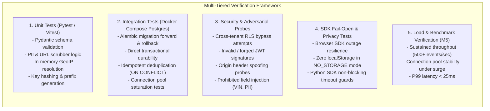

# Analytics Platform — Test Strategy & Acceptance Criteria

## 1. Overview & Verification Philosophy

To ensure reliability, multi-tenant isolation, data privacy, and zero degradation of client applications, the Analytics Platform mandates a rigorous, automated verification framework across all implementation milestones (**M1–M5**).

Both **AGY CLI** and **OpenAI Codex CLI** must run automated test suites, verify outcomes empirically, and document command outputs and skipped checks in task reports. **Never invent or assume test results.**

---

## 2. Test Suites & Verification Categories

### 2.1 Unit Tests (`tests/unit/`)
- **FastAPI Handlers:** Validate request parsing, status codes (`201`, `202`, `400`, `401`, `413`, `422`, `429`).
- **PII & URL Scrubbing:** Test that URLs containing query parameters (`token=abc`, `password=xyz`, `vin=123`, `email=test@example.com`) are deterministically sanitized to `[REDACTED]`.
- **Payload Validation:** Verify that payloads with prohibited fields (`vin`, `chat_message`, `ssn`) are rejected with `422 Unprocessable Entity`.
- **Key Hashing:** Ensure write keys are hashed with SHA-256 before database lookup.

### 2.2 Integration Tests (`tests/integration/`)
- **Database Migrations:** Run `alembic upgrade head` followed by `alembic downgrade -1` against a clean PostgreSQL 16 container, verifying zero migration errors.
- **Transactional Durability:** Verify that an event is written to disk and queryable immediately upon receiving HTTP 201/202.
- **Idempotency:** Submit duplicate events with identical `(event_id, timestamp)`. Verify that only one row is written and no duplicate records exist.
- **Batch Processing:** Verify `POST /v1/batch` persists all valid events in a single transaction.

### 2.3 Security & Adversarial Probes (`tests/security/`)
- **Negative Authentication:**
  - Submit events with invalid `write_key`, revoked key, expired key, or key from the opposite environment (`test` key to `live` endpoint). Verify rejection with `401 Unauthorized`.
  - Submit dashboard requests with forged JWT signatures, expired tokens, or missing `Authorization` headers. Verify rejection with `401 Unauthorized`.
- **Row-Level Security (RLS) Breach Attempts:**
  - Execute SQL queries simulating a compromised application layer attempting to query `app_id = 'roomlyst'` while session is set to `app.current_app_id = 'askanna'`. Verify PostgreSQL returns **0 rows**.
  - Attempt to read `live` data using a `test` session. Verify zero rows returned.
- **Origin Spoofing:**
  - Send requests with spoofed `Origin: https://malicious-site.com`. Verify CORS preflight rejection or server-side abuse flagging.
- **Secret Scanner:** Automated check verifying that no API keys, private keys, or passwords exist in plaintext in repository files.

### 2.4 Privacy & Fail-Open Verification (`tests/privacy/`, `sdk/*/tests/`)
- **Zero Raw IP Persistence:**
  - Inspect test database rows following event ingestion. Verify that no raw IP addresses are stored anywhere in the schema, and that only masked `/24` or coarse geo codes are present.
- **Consent Tier Behavior:**
  - In `NO_STORAGE` mode: verify zero cookies or `localStorage` keys are created.
  - In `ANONYMOUS` mode: verify `sessionStorage` is populated but `localStorage` remains empty.
  - In `ANALYTICS_ALLOWED` mode: verify persistent UUID is maintained.
- **SDK Fail-Open Resilience:**
  - Mock an offline or hanging analytics server (`500 Internal Error`, `503 Service Unavailable`, or dropped connection).
  - Verify that the browser SDK does not throw unhandled exceptions or block DOM rendering.
  - Verify that Python server middleware completes consumer API requests normally without latency degradation.

---

## 3. Measurable Acceptance Criteria by Milestone

### Milestone M0: Architecture and Planning (Current)
- [x] All 10 Architecture Decision Records (ADRs) defined and status marked.
- [x] System architecture, data model, API contracts, privacy safeguards, and threat model fully documented with Mermaid diagrams.
- [x] Unresolved technical decisions requiring stakeholder approval identified in decision table.
- [x] Zero infrastructure provisioning or code changes against cloud environments.
- [x] Repository skeleton directories (`api/`, `dashboard/`, `sdk/`, `infra/`, `tests/`) initialized with README guides.
- [x] Mandatory task report and M0 closure report created.

### Milestone M1: Foundation (Next Phase)
- **Alembic Migrations:** Clean execution of migrations and rollbacks against local PostgreSQL 16 container.
- **Core FastAPI App:** Serves `/health/live`, `/health/ready`, and administrative authentication.
- **RBAC & Isolation:** Adversarial tests verify PostgreSQL RLS prevents cross-tenant data leakage.
- **Key Hashing:** API write keys hashed with SHA-256; key generation and revocation verified.
- **Test Matrix:** 100% passing unit and integration test suite with coverage report.

### Milestone M2: Tracking & Ingestion
- **Browser SDK:** Compiled bundle size < 5 KB gzipped, zero external dependencies.
- **Consent Tiers:** Empirical verification of `NO_STORAGE`, `ANONYMOUS`, and `ANALYTICS_ALLOWED` modes.
- **Durable Ingestion:** Direct transactional write verified; zero RAM-only acknowledgment.
- **Privacy Pipelines:** Verified zero raw IP in database; automated URL query parameter scrubber cleans sensitive parameters.
- **Rate Limiting:** HTTP 429 returned when per-IP or per-key limits are exceeded.

### Milestone M3: Dashboard & Reporting
- **React 19 SPA:** Responsive dashboard displaying Overview, Pages, Geo, Device, and Visitor Journey views.
- **Environment Scoping:** Strict separation of `test` vs `live` metrics in UI.
- **Export Audit:** CSV/JSON export records an entry in `audit_logs` before file delivery.
- **RBAC Enforcement:** `AppViewer` cannot access key management or raw visitor timelines.

### Milestone M4: Integration SDKs & App Validation
- **Python SDK:** Async/sync tracking helper for FastAPI/Flask; fail-open on connection failure verified.
- **Sample App:** Standalone reference application demonstrating end-to-end integration.
- **Zero Consumer Edits:** No live changes made to AskAnna, GroundWorks, Roomlyst, or NutriLens without explicit authorization.

### Milestone M5: Hardening & Production Release
- **Release Blocker Closure:** Verification that Gate G1 security conditions in `leave-tracker-2025` are resolved, or dedicated GCP project is approved.
- **Load Benchmarks:** Benchmark sustained ingestion of 500+ events/second with bounded database connection handling and P99 latency < 25ms.
- **Backup & Recovery:** Validated restoration from Cloud SQL automated backup and PITR journal.
- **IaC & Runbook:** Terraform / Cloud Run deployment configuration peer-reviewed; zero autonomous cloud writes.
