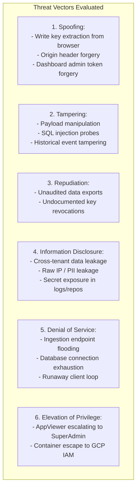

# Analytics Platform — Threat Model & Security Risk Register

## 1. Methodology & Scope

This threat model applies the industry-standard **STRIDE** methodology (Spoofing, Tampering, Repudiation, Information Disclosure, Denial of Service, Elevation of Privilege) to evaluate the security boundaries of the Self-Hosted Multi-Application Analytics Platform.

The scope encompasses:
- Public Ingestion Edge (`POST /v1/events`, `POST /v1/batch`)
- Client Applications (Browser SDK, Python SDK)
- Relational Storage Layer (PostgreSQL 16 & Cloud SQL)
- Administrative Management Layer (`analytics-dashboard`)
- Google Cloud Project Coexistence (`leave-tracker-2025` vs `enterprise-analytics-prod`)

---

## 2. STRIDE Threat Analysis

### 2.1 Spoofing Identity

#### Threat S-01: Extraction and Abuse of Browser Ingestion Keys
- **Description:** An attacker inspects client web source code on `askanna.ai` or network traffic to extract the `write_key`, then uses it to send fake events from a local script.
- **Severity:** Medium
- **Mitigations:**
  1. **Write-Only Capability:** Ingestion keys grant zero read or query permissions. Extraction exposes no existing analytics data.
  2. **Environment Scoping:** Keys are strictly bound to a single `(app_id, environment)`.
  3. **Origin Checking:** Ingestion API checks the `Origin` and `Referer` headers against the application's domain allowlist. Mismatched origins are rejected or flagged as untrusted.
  4. **Rate Limiting:** Aggressive rate limiting per `write_key` prevents massive spam floods.
  5. **Instant Key Revocation:** Administrators can revoke and re-issue keys via the dashboard without redeploying backend services.

#### Threat S-02: Dashboard Admin Impersonation / JWT Forgery
- **Description:** Attacker exploits weak, leaked, or hardcoded JWT signing keys to forge valid administrative tokens.
- **Severity:** Critical
- **Mitigations:**
  1. Dedicated, cryptographically strong 256-bit secret generated via `openssl rand -hex 32` stored exclusively in Google Secret Manager.
  2. Hardcoded fallback keys are strictly prohibited in application source code. The service refuses to start if `ANALYTICS_JWT_SECRET` is missing.
  3. Token lifetimes capped at 15 minutes; refresh tokens stored in HttpOnly, Secure, SameSite=Strict cookies.

---

### 2.2 Tampering with Data

#### Threat T-01: SQL Injection Probes via Dynamic Metadata or Query Parameters
- **Description:** Attacker submits malicious SQL payloads in event names, page paths, or JSON metadata to execute unauthorized SQL statements.
- **Severity:** Critical
- **Mitigations:**
  1. Complete prohibition of dynamic SQL string formatting.
  2. Strict parameterization using `asyncpg` prepared statements ($1, $2, ...) and SQLAlchemy 2.0 ORM expressions.
  3. JSON metadata is parsed and validated via Pydantic schemas prior to database execution.

#### Threat T-02: Tampering with Historical Telemetry Records
- **Description:** Compromised service or administrative user attempts to alter historical analytics figures.
- **Severity:** High
- **Mitigations:**
  1. Database user role for the ingestion API possesses `INSERT` permissions only on the `events` table (no `UPDATE` or `DELETE` grants).
  2. Partitioned child tables are append-only.
  3. Deletion operations are restricted to automated partition pruning (`DROP TABLE`) and audited GDPR purge procedures.

---

### 2.3 Repudiation

#### Threat R-01: Unaudited Administrative Actions & Data Exfiltration
- **Description:** A malicious insider or compromised admin account exports customer interaction data or revokes API keys without a trace.
- **Severity:** High
- **Mitigations:**
  1. Dedicated, append-only `audit_logs` table records every administrative login, key creation/revocation, role assignment, and data export.
  2. Export endpoints stream data only after an immutable audit log record is written to the database.

---

### 2.4 Information Disclosure

#### Threat I-01: Cross-Tenant Data Contamination / Leakage
- **Description:** A query bug or IDOR in the dashboard allows an AskAnna user to view Roomlyst or GroundWorks telemetry.
- **Severity:** Critical
- **Mitigations:**
  1. **Application Layer:** Middleware enforces mandatory `app_id` verification against the user's assigned RBAC permissions.
  2. **Database Layer (RLS):** PostgreSQL Row-Level Security policies are enforced at the database engine level. Even if an application query omits `WHERE app_id = ...`, PostgreSQL filters rows based on session variables (`app.current_app_id`), returning zero unauthorized records.
  3. **Adversarial Testing:** Automated CI test suite in M1 includes adversarial cross-tenant query probes.

#### Threat I-02: Exposure of Raw IP Addresses and Personally Identifiable Information (PII)
- **Description:** Visitor IP addresses, user emails, or secret tokens leaked in database backups or server logs.
- **Severity:** High
- **Mitigations:**
  1. Database schema excludes raw IP address columns.
  2. Ingestion pipeline performs in-memory GeoIP resolution and truncates/discards IP before database insertion.
  3. Automatic URL parameter scrubber strips sensitive query strings (`token`, `auth`, `password`, `email`).
  4. Pydantic validation rejects payloads containing `vin`, `chat_message`, `ssn`, or credit card numbers.

---

### 2.5 Denial of Service (DoS)

#### Threat D-01: Ingestion API Flooding & Connection Pool Exhaustion
- **Description:** Attacker launches an HTTP flood against `/v1/events` to overwhelm Cloud Run instances and exhaust PostgreSQL connection pools.
- **Severity:** High
- **Mitigations:**
  1. **Cloud Run Concurrency:** Instances handle up to 80 concurrent requests, absorbing traffic bursts.
  2. **Bounded Database Pools:** Ingestion container connection pools are capped (`min_size=2`, `max_size=10`). With `max_scale=20`, total connections cannot exceed 200, protecting PostgreSQL.
  3. **Rate Limiting:** In-memory sliding-window rate limiters drop abusive IPs (120 req/min) and keys (2,000 req/min) with `429 Too Many Requests`.
  4. **Payload Size Caps:** Hard rejection of payloads over 64 KB (`413 Payload Too Large`).

---

### 2.6 Elevation of Privilege

#### Threat E-01: Lateral Movement from Compromised Co-Hosted Service
- **Description:** Attacker compromises an over-privileged co-hosted service within a shared cloud project to access analytics database or storage infrastructure.
- **Severity:** Critical (Release Blocker)
- **Mitigations:**
  1. Analytics platform services execute strictly under dedicated least-privilege service accounts (`sa-analytics-ingest`, `sa-analytics-dashboard`).
  2. Recommended production deployment in an isolated dedicated GCP project (`enterprise-analytics-prod`).
  3. **Gate G1 Enforcement:** Shared-project production rollout is strictly blocked until project-level least privilege boundaries are verified.

---

## 3. Security Risk Register

| Risk ID | Vulnerability / Threat Scenario | STRIDE | Severity | Likelihood | Blast Radius | Mitigation Status |
|---|---|:---:|:---:|:---:|---|---|
| **SEC-01** | Co-hosting in shared cloud project without strict service account isolation | E | **Critical** | Medium | Entire GCP Project | **BLOCKED (Gate G1)**: Production rollout blocked pending isolation verification or dedicated project. |
| **SEC-02** | Cross-tenant data leakage in multi-tenant queries | I | **Critical** | Low | Multi-tenant Data Privacy | **Mitigated**: Defense-in-depth with PostgreSQL Row-Level Security (RLS) + API middleware. |
| **SEC-03** | Injection attacks via raw SQL or JSONB metadata | T | **Critical** | Low | Database Integrity | **Mitigated**: Parameterized asyncpg queries, Alembic migrations, Pydantic schema validation. |
| **SEC-04** | Hardcoded JWT secret key fallback in code | S | **High** | Medium | Admin Authentication | **Mitigated**: Mandatory Secret Manager injection; application fails to start if secret missing. |
| **SEC-05** | Raw IP or sensitive customer PII persisted in database | I | **High** | Medium | Regulatory (GDPR/CCPA) | **Mitigated**: Zero raw IP in DB schema; in-memory GeoIP resolution; URL parameter scrubber. |
| **SEC-06** | Database connection pool exhaustion via HTTP surge | D | **High** | Medium | Service Availability | **Mitigated**: Bounded connection pools, Cloud Run max instance caps, per-IP rate limiting. |
| **SEC-07** | Ingestion write key extraction from public web apps | S | **Medium** | High | Telemetry Data Pollution | **Mitigated**: Keys are write-only; origin allowlist checks; aggressive rate limiting; instant key rotation. |
| **SEC-08** | Client application disrupted by analytics outage | D | **Medium** | Low | Client App Availability | **Mitigated**: Strict fail-open contract in browser and Python SDKs; timeout guards. |
